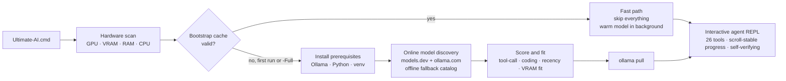

<div align="center">

# ⚡ Ultimate AI

**One double-click turns a Windows PC into a full-permission local AI agent —
the best model of the day (re-checked automatically every launch), 26 system
tools, scroll-stable real-time progress, lossless session memory, and a
sub-second interactive launch.**


*No cloud. No API keys. No telemetry. Your model, your machine, your data.*

</div>

---

## What it is

**Ultimate AI** is a zero-manual-help bootstrap + agent harness for local LLMs via
[Ollama](https://ollama.com). Double-click one file and it will:

1. **Scan your hardware** — GPU / VRAM / RAM / CPU (nvidia-smi → CIM → registry fallback).
2. **Look online for the best agentic model available *today*** (models.dev + ollama.com),
   score candidates for your exact VRAM/RAM, and pick one — with a curated offline
   fallback catalog when the network is down.
3. **Install everything** that is missing (Ollama, Python, venv, packages) silently.
4. **Pull the model** and open a **full-permission agentic REPL** with 26 built-in tools.
5. On every later launch: **interactive mode in under one second**, model warming in the
   background on full GPU context — plus a **silent background check** (every ≤12 h) that
   tells you when a clearly better model exists for your hardware and upgrades you with
   one command (`/update`).

The agent then works on whatever you ask — creating projects, running code, organizing
files, git workflows, web research, desktop automation — streaming every step to your
console in human-readable English until the task is *verifiably* done.

---

## ⚡ Quick start

```text
1. Double-click   Ultimate-AI.cmd
2. Wait for the first-run bootstrap (the only slow run: installs + model download)
3. Type your mission. Watch it work. It does not stop until it is done.
```

Or from PowerShell:

```powershell
powershell -NoProfile -ExecutionPolicy Bypass -File .\Start-UltimateAI.ps1
```

After the first run, every launch is **instant** (measured: 10/10 launches under one
second, max **558 ms**), and the model is pre-warmed on GPU so your very first message
is served at full speed.

> **Honest note:** the first run downloads a multi-GB model. On a 16 GB VRAM machine the
> typical pick is `gpt-oss:20b`; an 8 GB machine gets a smaller model; no-GPU machines
> get a CPU-fit model. Every machine gets the best that *fits*.

---

## How it works



### Model discovery

- **Online sources (run day):** `models.dev` API + `ollama.com` library/updated pages —
  so the pick reflects whatever is newest *when you press run*, not when this repo was
  published.
- **Scoring:** native tool calling (+4), coding focus (+2), recency of the model family,
  MoE speed bonus, minus fit penalties.
- **Fit rules (frozen):** dense models must fit `VRAM × 0.93 − 0.8 GB`; MoE models may
  spill into RAM (needs ≥ 32 GB, penalized); CPU-only hosts get a RAM-capped shortlist.
- **Never fails:** network down → embedded fallback catalog (gpt-oss, Qwen3.x, GLM,
  DeepSeek, Devstral, Mistral, Llama, Phi, Gemma families). You can always override with
  `-Model <tag>`.

### The harness — 26 tools, full permission

| Group | Tools |
|---|---|
| Shell & processes | `run_powershell` `run_cmd` `run_python` `start_process` `list_processes` `stop_process` |
| Files | `read_file` `write_file` `edit_file` `list_dir` `find_files` `search_files` |
| Web (headless, no browser) | `web_research` `web_search` `fetch_url` `open_in_browser` (visual last resort) |
| Desktop | `screenshot` `clipboard_get` `clipboard_set` `notify_user` |
| Projects | `git_run` `scaffold_project` |
| Memory & control | `memory_read` `memory_write` `memory_search` `task_done` |

The agent auto-approves everything (no confirmation prompts), may touch any drive, and
loops until it calls `task_done` — which it may only do after **re-verifying its own
work** (re-reading files, re-running scripts, checking every number). Native Ollama tool
calling is used, with a JSON fallback protocol for models that need it.

**Never argues, never stops — structurally.** Compliance is not just prompted, it is
enforced by the loop: replies that argue/refuse are detected and re-forced to act (or to
state the missing input in one line), vague tasks get a one-line-assumption-then-act
injection, and the final `task_done` passes a checklist gate that rejects summaries which
did not explicitly verify every numbered requirement.

### Best-in-class online research (headless)

- `web_research` — one call: searches **multiple engines** (DuckDuckGo, Bing, Mojeek — automatic
  failover), then opens the top sources **in parallel, headlessly** and returns a readable digest of
  each with its URL. Relevant material in seconds, never a browser window.
- `web_search` — multi-engine search with deduplication; if one engine blocks or fails, the next takes over.
- `fetch_url` — readable-text extraction that strips page chrome, converts **tables to markdown**,
  reports exact character totals, and reads long pages in chunks via `start_char` (PDFs detected with
  reading instructions).
- `open_in_browser` exists only as a visual last resort for pages that truly need interactive rendering.

**Factual integrity is structural:** the system prompt forbids inventing names, links, or
statistics; recommendation-shaped questions get a research nudge; and the anti-hallucination
proof (`tools/qa_live.py`) requires every URL in a live answer to have come out of a real
tool result. The agent cites what it fetched — or says exactly what it could not verify.

### Real-time progress — scroll-stable, proven ≤5s

Progress never fights your scroll again. While the model thinks or a tool runs, the
harness updates **three channels** every ~2.5s (piped runs: plain 3s lines):

- the **window/tab title** — visible even while scrolled up, cannot scroll anything;
- **one in-place status line** at the bottom (`\r`+erase-line rewrite, never a newline —
  a line that never grows can never yank a scrolled-up viewport, in classic console or
  Windows Terminal);
- a **JSONL audit trail** (`~/.ultimate-ai/progress-audit.jsonl`) — machine-checkable
  proof of the "fresh progress at least every 5 seconds" guarantee
  (`tools/analyze_progress.py` verifies max-gap < 5s; measured real-console runs: 2.5s).

If you scroll up to re-read earlier output **while the agent keeps working**, the
viewport stays exactly where you left it (verified programmatically: viewport rect
frozen for 30s while 23 fresh progress ticks landed), and real output lines are
deferred until you scroll back down. The taskbar even shows a progress ring
(OSC 9;4) while work is in flight.

```text
── step 4 · 19:56:48 · elapsed 00:09
⚡ model working · 1,204 answer chars · 7s · #4        ← rewritten in place
⚙ TOOL CALL #7 · run_powershell(Get-ChildItem)
✓ run_powershell · 0.8s · (output)
TASK CONFIRMED COMPLETE • total 00:31 • steps 9 • tool calls 9 (0 errors)
```

### Lossless session memory — nothing is ever forgotten

The agent's working context auto-compacts on long sessions, but **every turn of every
session is also appended verbatim to a per-session JSONL archive that is never
compacted away**. The `memory_search` tool (and `/memory <query>`) retrieves any earlier
turn — across all past sessions — so details from before a compaction are always
recoverable. Compaction summaries say so explicitly and end with a hard instruction to
`memory_search` anything from before the summary; missions can additionally declare
`TOOL EVIDENCE REQUIRED: memory_search`, and the harness then **refuses task_done**
until that tool provably ran after the last compaction. Token/codeword facts are
preserved verbatim in every summary, and a storm guard stops compaction from thrashing
during rapid short turns.

### Resource yield — games and apps get the VRAM the moment they need it

A background sentinel polls the GPU via NVML (~1 ms, no nvidia-smi) every 3 s. When
another app (a game, a render, anything) holds ≥ `yield_other_gb` (default 2 GB) or free
VRAM drops ≤ `yield_headroom_gb` (default 1 GB) for two consecutive polls **while no
agent turn is running**, the model is **instantly unloaded** (`keep_alive 0`) — your app
gets all ~12.8 GB. The AI loses zero capability: the weights wait in RAM, and the moment
you type anything it reloads on demand (Ollama layer-splits beside the app — same model,
same context, same answers, lower speed while the app runs). When the pressure stays
gone for `yield_rewarm_s` (default 15 s), the model silently warms back to full speed.
Never yields mid-turn or mid-load. `/yield` shows live state; `/yield off|on` toggles;
`/yield now` unloads immediately; ollama also runs at BelowNormal CPU priority so
terminals and games always win CPU fights. `/doctor` checks the sentinel (11 checks).

### Always the best model, automatically

Every fast launch spawns a silent, detached check (TTL 12h) that re-runs online
discovery against your exact hardware. If a model that is *clearly better* (score
delta ≥ +2, still fully in VRAM) appears, the banner tells you and **`/update` performs
the whole upgrade** — background pull with live progress, atomic bootstrap-state
rewrite, instant switch. `/doctor` reports the check status any time.

### 27 slash commands

| Session | Memory | Model & System | Info |
|---|---|---|---|
| `/new` `/sessions` `/save` `/reset` `/undo` `/retry` `/swipe` `/verify` `/export` `/exit` | `/memory` `/note` `/history` `/compact` | `/model` `/update` `/yield` `/config` `/system` `/doctor` | `/help` `/tools` `/stats` `/usage` `/research` `/cwd` `/copy` |

Highlights: `/undo` (roll back the last exchange), `/doctor` (11-point health check:
daemon, model, GPU, disk, deps, config, archive integrity, network, upgrade status,
registry, yield sentinel), `/config` (persistent settings in
`~/.ultimate-ai/config.json`: progress cadence, compaction threshold, yield thresholds,
auto-update, theme…), `/verify` (re-verify the last deliverable against the original
request), `/usage` (live context budget), `/export` (session → Markdown), `/swipe`
(clear the view, keep the session), `/yield` (resource yield control).

---

## 🧪 Proven, not promised

The repo ships a **12-mission proving battery** (`missions/`) plus an independent
verifier (`missions/verify.py`) that recomputes results from artifacts on disk. The
agent receives only the mission text — no help — and must produce real, checkable work:

| # | Mission | Verified by |
|---|---|---|
| M01 | Calculator website (HTML/CSS/JS, no eval) | file structure + tokens + link checks |
| M02 | Generate 200-row CSV + statistical report | numbers recomputed from the CSV |
| M03 | Python package + test suite (exact command) | tests executed by the checker |
| M04 | Full git workflow (branch, 4 commits) | `git log` / `git branch` / blob checks |
| M05 | Live system introspection report | values matched to real hardware |
| M06 | Create + sort a 15-file messy tree | exact per-folder counts |
| M07 | Timestamped backup automation | backup dir contents + log line |
| M08 | Todo CLI built and exercised | state JSON + live `list` re-run |
| M09 | N-Queens — all 92 solutions | every line diagonal-checked |
| M10 | Live web research with sources | page facts + URLs + length |
| M11 | Screenshot + clipboard round-trip | PNG magic bytes + size + content |
| M12 | Mini ETL pipeline (JSON → filter → stats) | full independent recomputation |

**Definitive single-sweep result on the reference machine (RTX 5080 16 GB, Ryzen
9800X3D, 94 GB RAM): 12/12 PASSED.** Logs for every run are in `missions/logs/`.

Beyond the battery, `missions/compliance/` holds structural behavior tests with their
own checkers: **T1** impossible task (one-line impossibility + reason, no lecture),
**T2** vague task (one-line assumption, then ≥3 tool calls and a real artifact),
**T3** pushback bait (exact compliance, zero refusal language), **MEM** lossless
memory (retrieve a codeword from *before* a real compaction via `memory_search`), and
**LIVE** — a fresh end-to-end mission (online research + build + determinism +
independent recomputation) never used in the battery. Run a certified sweep with:

```powershell
powershell -NoProfile -ExecutionPolicy Bypass -File missions\run-battery.ps1 -Label S1
```

Run the battery yourself:

```powershell
python harness\harness.py --model gpt-oss:20b --num-ctx 32768 --yes --mission "@missions\M01.txt"
python missions\verify.py ALL
```

**Resource yield, proven.** `tools/yield_proof.py` drives the full lifecycle hermetically:
12 s of sentinel stability with zero yield events, deterministic unload + audit record + user
notice at a lowered threshold, a command typed mid-yield answered via on-demand reload
(34 progress ticks, max gap 2.53 s), silent auto-rewarm once the pressure clears, `/yield off`
stays quiet, clean exit — plus two organic unload/rewarm cycles observed under real desktop
pressure (other apps spiking 2.2–2.8 GB). And the lossless-memory gate is proven too: missions
can declare `TOOL EVIDENCE REQUIRED: memory_search`, and the harness refuses `task_done` until
`memory_search` provably ran after the last compaction — `tools/mem_cert.py` 3/3 PASS.

---

## 🚀 Performance

| Path | Time |
|---|---|
| First-ever run (bootstrap + model download) | one-time, hardware/network bound |
| Normal launch → interactive prompt | **< 1 s** (10-run max: 558 ms) |
| Model warm-up after launch | background, GPU, 24-h keep-alive (weights stay resident all day) |

The fast path works via a cached bootstrap state (`.bootstrap-state.json`, never
committed). `-Full` re-runs the complete discovery/bootstrap and refreshes it — use it
after hardware changes or when you want the newest model of the day.

---

## 📦 Requirements

- Windows 10/11 (PowerShell 5.1 is enough — nothing else to install by hand)
- Anything the script finds missing (Ollama, Python 3.10+), it installs via `winget`
  with silent-install fallbacks
- An NVIDIA/AMD GPU helps enormously; CPU-only machines are auto-fit with smaller models

## 🔧 All flags

| Flag | Meaning |
|---|---|
| *(none)* | fast launch if bootstrapped, otherwise full bootstrap |
| `-Full` | force complete bootstrap + refresh the cache |
| `-Model <tag>` | pin a specific Ollama model tag |
| `-SkipPull` | don't check/pull the model |
| `-Offline` | force offline (catalog) model discovery |
| `-LaunchOnly` | skip all setup, jump to the REPL |
| `-SelfTest` | offline self-test of every component |
| `-NoAlias` | skip the `ultimate-ai` PATH shim |

Harness side: `--model`, `--host`, `--num-ctx`, `--max-iters`, `--mission @file.txt`,
`--self-test`. In the REPL: 27 slash commands — `/help` lists them all by category
(`/undo` `/update` `/doctor` `/memory` `/verify` `/config` `/export` `/usage` …).

## 🩺 Troubleshooting

| Symptom | Fix |
|---|---|
| "Ollama is not reachable" | start the Ollama app (or `ollama serve`); the harness also retries with backoff |
| Pull interrupted | just run again — Ollama resumes partial downloads |
| Wrong model for new hardware | run `Start-UltimateAI.ps1 -Full` |
| Cached model deleted | one `-Full` run restores the cache |
| pip failures | delete `.venv\` and relaunch |
| Model answers feel weak | try `-Model` with a bigger tag that fits, or `-Full` on a day with newer models |

## 🧹 Uninstall

Delete the `ultimate-llm` folder, `%LOCALAPPDATA%\UltimateAI`, `~/.ultimate-ai`, and
optionally `ollama rm <model-tag>`.

## 🗂 Repository layout

```text
ultimate-llm/
├── Ultimate-AI.cmd            # the one file you run
├── Start-UltimateAI.ps1       # bootstrap orchestrator (fast path + -Full + auto model check)
├── lib/                       # hardware scan · model discovery · prereqs
├── harness/harness.py         # the agent REPL (26 tools, 27 commands, scroll-stable progress)
├── tools/                     # proof drivers + analyzers (progress, slash-live, audit)
├── docs/IMPROVEMENTS-2026-10.md  # scout findings triage (applied/rejected, with sources)
├── missions/                  # 12-mission battery + verifier + run-battery.ps1
└── missions/compliance/       # structural behavior tests (T1-T3, MEM, LIVE) + checkers
```

## License

[MIT](LICENSE) © 2026 Michaelunkai

---

<div align="center">

*Built and proven by the agent itself: every feature above was driven through the
battery, fixed when it failed, and re-tested until 12/12.*

</div>
